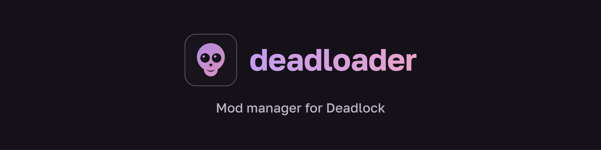

<p align="center"></p>

# deadloader

A portable, transparent mod manager for [Deadlock](https://store.steampowered.com/app/1422450/) with a built-in
[GameBanana](https://gamebanana.com/games/20948) catalog. Windows 10/11 (x64).

- Browse, search and install mods and sounds from GameBanana inside the app.
- Keep a local library; enable, disable and order mods; switch between profiles.
- Every network request and every file operation is shown in the app and written to a log.
- deadloader talks only to GameBanana. No account, no telemetry, no backend of its own.
- Everything it changes in the game can be undone with one click.

deadloader is not affiliated with Valve or GameBanana.

> **Status:** early development (0.x versions) — expect rough edges, and please report them.

## Download
Get `deadloader-<version>-windows-x64.zip` from [Releases](https://github.com/horexdev/deadloader/releases). It holds
`deadloader.exe`, its licence and `THIRD-PARTY-NOTICES.txt`. Each release lists the SHA-256 of the zip and of the exe
and is built by GitHub Actions with an
[artifact attestation](https://docs.github.com/actions/security-for-github-actions/using-artifact-attestations):
```
gh attestation verify deadloader-0.1.0-windows-x64.zip --repo horexdev/deadloader
```
Releases are not code-signed yet, so Windows may show "Windows protected your PC" — choose "More info → Run anyway"
after checking the hash.

## Install
deadloader is a single exe and needs no installation.
1. Unpack the zip into its own folder **you can write to**, ideally on the same drive as Deadlock, e.g.
   `D:\Games\deadloader\`. Not `Program Files` (read-only for normal users), not Downloads or the Desktop.
2. Run it. A short first-run guide explains what it does and lets you choose between the catalog and local mode.

If deadloader says it can't save its data, the folder is read-only: move the folder somewhere else.

## Where your data lives
Everything is in `deadloader-data\` next to the exe: library, profiles, settings, cache, logs and the WebView2
profile. Nothing is written to `%APPDATA%` or the registry.

One exception: when the folder is read-only, deadloader can't keep anything there, so the window that tells you so
keeps the WebView2 profile in `%TEMP%\deadloader-webview-<process id>` and deletes it on exit.

In the game, deadloader only adds mod files to `game\citadel\addons\` and one line to `game\citadel\gameinfo.gi`.

## Uninstall
Settings → Game → **Rollback** removes everything deadloader put into the game. Then delete the deadloader folder.

## Network
With the catalog on, deadloader connects only to `gamebanana.com`, `images.gamebanana.com`, `files.gamebanana.com`
and `filecache<number>.gamebanana.com` — plus image hosts you allow for mod descriptions, and GitHub if you enable the
deadloader update check. In local mode it makes no network requests at all.
The window is drawn by Microsoft WebView2, part of Windows. deadloader starts it with its online features
(DNS-over-HTTPS, Microsoft account sign-in, SmartScreen, component updates and others) switched off and gives it no
route to the internet; WebView2 itself is updated by Windows.

## Privacy
deadloader collects nothing and sends nothing about you. It transfers no information to other networked systems
unless you ask for it: GameBanana when you turn the catalog on, image hosts you allow, and GitHub when you enable the
update check (see [Network](#network)). Logs stay on your PC and hide your Windows user name.
Requests to GameBanana are subject to GameBanana's [Terms of Service](https://gamebanana.com/wikis/334).

## Code signing policy
Free code signing provided by [SignPath.io](https://about.signpath.io/), certificate by
[SignPath Foundation](https://signpath.org/).

- Committers and reviewers: [horexdev](https://github.com/horexdev)
- Approvers: [horexdev](https://github.com/horexdev)

Every signed release is built by GitHub Actions from a tagged commit of this repository and approved by hand.
Privacy: see [Privacy](#privacy). Releases up to 0.1.0 are not signed; signing starts once SignPath Foundation
approves the project.

## License
[GPL-3.0](LICENSE). Mods are made by their authors and are subject to their own licences; you use them at your own risk.
